# FingerMonster - Aşama 1 Sentez Raporu ve Öncelikli Düzeltme Planı

Bu belge, **Aşama 1 (Araştırma)** kapsamında 5 uzman alt ajanın (`unity-compile-fixer`, `unity-lifecycle-reviewer`, `unity-scene-auditor`, `unity-netcode-reviewer`, `unity-ui-input-reviewer`) bağımsız olarak tespit ettiği kanıtlı bulguların sentezini, ortak kök neden analizini ve **Aşama 3 (Düzeltme)** için dosya sahipliği planını içerir.

---

## 1. ORTAK KÖK NEDEN ANALİZİ (ROOT CAUSE ANALYSIS)

Raporlar birleştirildiğinde projedeki birçok belirtinin birkaç temel mimari kök nedenden kaynaklandığı doğrulanmıştır:

```mermaid
flowchart TD
    RC1["Kök Neden 1: Sahne Kurulumu ve Mükerrer Nesneler (SceneSetupTool & Game.unity)"] --> SYM1["Çift NetworkManager (Netcode Çökmesi)"]
    RC1 --> SYM2["Çift GameManager / NetworkGameManager Çakışması"]
    RC1 --> SYM3["Çift Karakter (Frame 0'da T-pose + Oturan Karakter)"]
    
    RC2["Kök Neden 2: Editör Otomasyonu ve Yaşam Döngüsü Tuzakları"] --> SYM4["FindInvalidAABBInScene [InitializeOnLoadMethod] -> Her derlemede zorla Game.unity açılması"]
    RC2 --> SYM5["ExecutionReflectionSystem OnDestroy -> renderer.material erişimi ve 'Some objects not cleaned up' hatası"]
    RC2 --> SYM6["Singleton'larda ters Destroy(Instance.gameObject) deseni"]

    RC3["Kök Neden 3: URP VolumeProfile ve Layer Tanımsızlığı"] --> SYM7["DefaultVolumeProfile.asset -> 5 sahte test bileşeni (m_Script null) -> VolumeComponent.OnDisable NullReferenceException"]
    RC3 --> SYM8["TagManager.asset -> Layer 10 (ButcherSecret) tanımlı değil -> Kasabın ana sahnede görünme riski"]

    RC4["Kök Neden 4: Netcode Senkronizasyon ve Threading Hataları"] --> SYM9["LANDiscovery ReceiveThreadLoop -> Time.time Main Thread hatası -> Odaların listeden anında silinmesi"]
    RC4 --> SYM10["NetworkPlayerSlot.Equals -> Sadece ClientId ve SeatIndex kontrolü -> El kopması/elenmenin istemciye replike olmaması"]
    RC4 --> SYM11["NetworkGameManager DetermineLocalSeat race condition -> İstemcinin koltuğunun 0'da takılı kalması ve turun kilitlenmesi"]

    RC5["Kök Neden 5: UI & Girdi & Yeniden Oynatma Akışı"] --> SYM12["Emote Q/E -> GameManager.StartRound'da yaşayan hedeflerin yenilenmemesi"]
    RC5 --> SYM13["GameOverUIController Restart -> Multiplayer maçta NetworkManager.Shutdown çağrılıp solo oyuna düşülmesi"]
```

---

## 2. ÖNCELİKLİ DÜZELTME LİSTESİ VE DOSYA SAHİPLİĞİ

Aşağıdaki sıra, sistemlerin birbirine bağımlılığına göre belirlenmiştir:

| Öncelik | Kategori | Dosya(lar) | Atanan Alt Ajan | Yapılacak Kesin Düzeltme |
|:---|:---|:---|:---|:---|
| **P1** | **Derleme & Otomasyon Kilidi** | `CartoonFXManager.cs` `FindInvalidAABBInScene.cs` `GameAutomatedTest.cs` | `unity-compile-fixer` | 1. `CartoonFXManager.cs`: Derleme temizliğini doğrula. 2. `FindInvalidAABBInScene.cs`: Satır 10'daki `[InitializeOnLoadMethod]` niteliğini ve satır 63'teki hatalı boş text `sz.sqrMagnitude < 0.000001f` kontrolünü kaldır. 3. `GameAutomatedTest.cs`: Satır 303/307 kemik scale testini 0.0001f kuralına uyarla. |
| **P2** | **Volume NullReferenceException & Layer** | `DefaultVolumeProfile.asset` `TagManager.asset` | `unity-scene-auditor` | 1. `DefaultVolumeProfile.asset`: Test kütüphanesine ait 5 sahte test bileşenini (`m_Script: {fileID: 0}`) temizle. 2. `TagManager.asset`: Katman 10'a `"ButcherSecret"` adını ata. |
| **P3** | **Çift NetworkManager & Yaşam Döngüsü Temizliği** | `SceneSetupTool.cs` `ExecutionReflectionSystem.cs` `GameManager.cs` `AudioManager.cs` `RoomLightingController.cs` | `unity-lifecycle-reviewer` | 1. `SceneSetupTool.cs`: `Game.unity` içindeki gereksiz statik NetworkManager Root'unu kaldır. 2. `ExecutionReflectionSystem.cs`: `OnDestroy`'da `material` yerine `sharedMaterial` kullan, `DestroyImmediate` yerine `Destroy` kullan. 3. `GameManager`, `AudioManager`, `RoomLightingController`: Ters singleton kalıbını (`Destroy(Instance.gameObject)`) standart `Destroy(gameObject); return;` kalıbına çevir. `AudioManager`'ı DontDestroyOnLoad yap. |
| **P4** | **Netcode & LAN Çökme Düzeltmeleri** | `LANDiscovery.cs` `NetworkPlayerSlot.cs` `NetworkGameManager.cs` `NetworkRoomManager.cs` | `unity-netcode-reviewer` | 1. `LANDiscovery.cs`: Arka plan thread'indeki `Time.time` çağrısını `Stopwatch` ile thread-safe hale getir. 2. `NetworkPlayerSlot.cs`: `Equals` içine `IsAlive`, `RemainingHands`, `Score` alanlarını ekle. 3. `NetworkGameManager.cs`: `HandlePlayerSlotsChanged` içine `DetermineLocalSeat()` ve `ConfigureLocalCameraForSeat()` ekle; eksik `OnDestroy` ve event unsubscription'ı ekle. 4. `NetworkRoomManager.cs`: MainMenu'ye dönüşte sahneden gelen mükerrer nesneyi Awake anında yok et. |
| **P5** | **UI, Input, Kamera & Yeniden Oynatma** | `CooldownRing` (`Game.unity`) `EmoteWheelUI.cs` `ExecutionReflectionSystem.cs` `GameOverUIController.cs` `PlayerSeat.cs` | `unity-ui-input-reviewer` | 1. `CooldownRing`: `raycastTarget = 0` yap. 2. `EmoteWheelUI.cs`: Yaşayan rakip kalmadığında/1 kaldığında durum geri bildirimi ver. 3. `ExecutionReflectionSystem.cs`: `LookAt` öncesi sıfır vektör ve dikey eksen kontrolü ekle. 4. `GameOverUIController.cs`: Çok oyunculu modda sunucu üzerinden sahne senkronizasyonu sağla. 5. `PlayerSeat.cs`: Karakter değiştirirken eski avatarı önce `SetActive(false)` yapıp sonra `Destroy` et. |

---

## 3. AŞAMA 3 (DÜZELTME) UYGULAMA SIRASI

Çakışmaları önlemek için düzeltmeler sırayla yürütülecektir:
- **Grup 1**: P1 (Derleme ve Editör Kilidi)
- **Grup 2**: P2 (Volume Profile ve Layer)
- **Grup 3**: P3 (Yaşam Döngüsü ve Sahne Mimarisi)
- **Grup 4**: P4 (Netcode Altyapısı)
- **Grup 5**: P5 (UI, Kamera ve Yeniden Oyna)

Her gruptan sonra Unity derleme durumu `Editor.log` üzerinden doğrulanacaktır.

