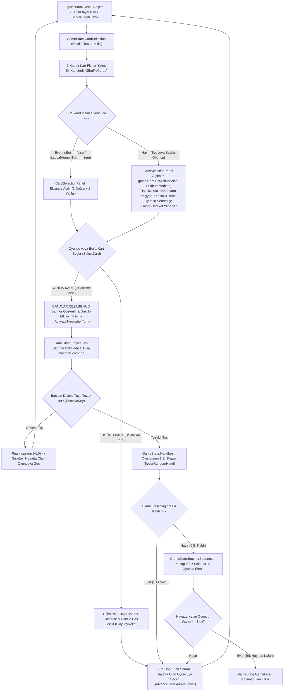

# FingerMonster — 3-Kart Seçim ve Daktilo Kader Mekaniği Uygulama Rehberi

Bu belge, **FingerMonster** projesindeki **3-Kart Kader Mekaniği (Push-Your-Luck Card Selection)** sisteminin oyun akışını, **Kart Görünürlük ve Kesintisiz Emote/Hareket Mimarisini**, üretim kodu yapısını (dosya ve satır referanslarıyla), yapay zekâ (Bot) entegrasyonunu, LAN Multiplayer (`Unity Netcode for GameObjects`) senkronizasyonunu, Unity Editor sahne kurulumunu ve sorun giderme (Troubleshooting) adımlarını eksiksiz olarak açıklar.

---

## 1. Oyun Akışı Özeti ve Görünürlük Kuralı (3-Kart Kader Mekaniği)

Her oyuncunun sırası başladığında (`BeginPlayerTurn` / `ServerBeginTurn`), oyuncu doğrudan daktilo tuşlarına basmaz; önce **3-Kart Kader Seçimi** aşamasına (`GameState.CardSelection`) girer:

1. **3 Kapalı Kartın Karıştırılması (`ShuffleCards`) ve Görünürlük Kuralı**:
   - Her tur başında **3 karttan 1 tanesi DOĞRU (Güvenli Geçiş / Pas Kartı — `isSafe = true`)**, **2 tanesi YANLIŞ (Canavar / Daktilo Cezası Kartı — `isSafe = false`)** olarak **Fisher-Yates** algoritmasıyla rastgele karıştırılır (`ShuffleCards`).
   - **Kartlar Yalnızca Sırası Gelen Yerel Oyuncuda Gözükür**:
     - Sıra **yerel insan oyuncuda** (`isBot == false` / LAN'da `isLocalHumanTurn == true`) olduğunda `CardSelectionPanel` ekranda açılır ve oyuncu 3 kapalı karttan birini seçer.
     - Sıra **başka bir oyuncuda veya botta** (`isBot == true` / LAN'da `isLocalHumanTurn == false`) olduğunda `CardSelectionPanel` yerel oyuncunun ekranında **kesinlikle açılmaz** (`panelRoot.SetActive(false)` / `HideImmediate()`).
     - Bunun yerine sadece üst HUD üzerinde `"Sıra: <Oyuncu> — Kader kartı seçiyor..."` bilgisi ve kart seçildiğinde sonuç banner'ı (`"<Oyuncu> DOĞRU KARTI BULDU!"` / `"<Oyuncu> YANLIŞ KARTI SEÇTİ!"`) gösterilir.
   - **Kesintisiz Emote ve Hareket Animasyonları**:
     - Sıra yerel oyuncuda değilken tam ekran kart paneli açılmadığı için 3B sahne ve alt `EmoteBar` butonları tamamen açık kalır; yerel oyuncu `1-5` kısayolları, `Q/E` hedef değiştirme, `C` emote çarkı ve alt emote butonlarıyla diğer oyunculara istediği gibi hareket/emote animasyonu yapabilir.
2. **Doğru Kart Seçilirse (`isSafe == true`)**:
   - Oyuncu daktiloda **hiçbir tuşa basmadan** turu güvenle atlar (pas geçer).
   - Avatar sevinç/rahatlama tepkisi (`PlayJoyRelief`) verir ve sıra doğrudan bir sonraki hayatta olan oyuncuya devredilir (`AdvanceToNextAlivePlayer` / `ServerAdvanceToNextAlivePlayer`).
3. **Yanlış Kart Seçilirse (`isSafe == false`)**:
   - Oyuncu **Canavar (Daktilo Cezası)** kartını çekmiştir; daktilo tuşlarına basma aşaması etkinleştirilir (`GameState.PlayerTurn`, `ActivateTypewriterTurn` / `ServerActivateTypewriterTurn`).
   - Oyuncu daktilodaki basılmamış harf tuşlarından birine basmak **zorunda kalır**:
     - **Güvenli tuşa basarsa**: Puan kazanır ve sıra bir sonraki hayatta olan oyuncuya geçer.
     - **Tuzaklı tuşa basarsa**: `GameState.HandLost` tetiklenir ve oyuncunun sağlam ellerinden biri kopar (`SeverRandomHand`). İki elini de kaybeden oyuncu için **Kasap İnfaz Sekansı (`GameState.ButcherSequence`)** başlar ve oyuncu maçtan elenir.
4. **Oyun Sonuna Kadar Döngü**:
   - Bu döngü, masada **tek bir oyuncu hayatta kalana kadar** her oyuncunun sırası geldiğinde kartlar yeniden rastgele karıştırılarak kesintisiz devam eder.



---

## 2. Mimari ve Kod Yapısı (Dosya ve Satır Referanslarıyla)

### Bölüm 1 — `GameState` (`GameEnums.cs`) ve Daktilo Tuş Kilidi

- **Dosya**: [GameEnums.cs](file:///c:/Users/mgunh/Desktop/New_GameFingerMonster/FingerMonster/Assets/Scripts/Core/GameEnums.cs#L6-L17)
- `GameState` enum yapısında `RoundStart` ile `PlayerTurn` arasına `CardSelection` durumu (`Satır 10`) yerleştirilmiştir:
  ```csharp
  public enum GameState
  {
      Lobby,              // Lobi / Bekleme aşaması
      RoundStart,         // Yeni tur hazırlığı ve tuzakların dağıtımı
      CardSelection,      // 3 Kart seçimi (Push-Your-Luck mini-oyun: 1 Güvenli, 2 Canavar)
      PlayerTurn,         // Sırası gelen oyuncunun daktilo tuşuna basma anı (kartta canavar çıkarsa)
      KeyResolve,         // Tuşa basıldı, güvenlik/tuzak kontrolü
      HandLost,           // Tuzak tetiklendi, oyuncunun eli koptu efekti
      ButcherSequence,    // İki eli giden oyuncunun başında kasap belirir
      RoundEnd,           // Tur sonuçlandırılıyor
      GameOver            // Oyun bitti, kazanan belirlendi
  }
  ```
- **Otomatik Daktilo Kilidi Mekanizması**:
  - [PlayerInputHandler.cs](file:///c:/Users/mgunh/Desktop/New_GameFingerMonster/FingerMonster/Assets/Scripts/Player/PlayerInputHandler.cs#L45-L65) içinde hem LAN ağ modunda (`CurrentNetworkState.Value != GameState.PlayerTurn`, `Satır 49`) hem de yerel modda (`GameManager.Instance.CurrentState != GameState.PlayerTurn`, `Satır 59`) kontrolü bulunur.
  - [TypewriterKey.cs](file:///c:/Users/mgunh/Desktop/New_GameFingerMonster/FingerMonster/Assets/Scripts/Gameplay/TypewriterKey.cs#L156-L179) içinde `HandleHover` (`Satır 158`) ve `HandleClick` (`Satır 169`) metotları `GameManager.Instance.CurrentState != GameState.PlayerTurn` koşulunu denetler.
  - Bu sayede oyun `GameState.CardSelection` aşamasındayken 3B daktilo tuşlarına fare (Raycast), klavye veya gamepad ile basılması **otomatik olarak kilitlenir**; oyuncu kart seçmeden hiçbir daktilo tuşunu tetikleyemez.

---

### Bölüm 2 — `CardSelectionController.cs`

- **Dosya**: [CardSelectionController.cs](file:///c:/Users/mgunh/Desktop/New_GameFingerMonster/FingerMonster/Assets/Scripts/Gameplay/CardSelectionController.cs#L1-L356)

1. **`CardElement` Veri Yapısı (`Satır 11-24`) ve Durum Özellikleri (`Satır 54-56`)**:
   - `CardElement`: Her bir kartın UI bileşenlerini (`button`, `cardBackImage`, `cardFrontRoot`, `frontIcon`, `frontText`, `rectTransform`) ve o turdaki kader durumunu (`isSafe`) tutan serileştirilebilir sınıftır.
   - `IsLocalCardPanelOpen` (`Satır 56`): `isShowingSelection && panelRoot != null && panelRoot.activeSelf` ifadesiyle kart panelinin **yerel oyuncunun ekranında fiilen açık olup olmadığını** döndürür. `EmoteWheelUI` bu özelliği kontrol ederek yalnızca yerel oyuncunun kendi kart seçim ekranı açıkken emote/hareket kısayollarını askıya alır; sıra botta veya başka bir oyuncudayken `IsLocalCardPanelOpen == false` olduğu için yerel oyuncu serbestçe emote yapabilir.

2. **`EnsureInitialized()` ve `isShowingSelection` Yaşam Döngüsü Koruması (`Satır 49-90`)**:
   - Unity'de başlangıçta pasif (`SetActive(false)`) olan `CardSelectionPanel` ilk kez `ShowCardSelection` içinde `panelRoot.SetActive(true)` yapıldığında Unity motoru o anda `Awake()` metodunu senkron olarak tetikler.
   - Eğer `Awake()` koşulsuz olarak `panelRoot.SetActive(false)` çağırırsa, ilk turda açılan kart paneli açıldığı anda geri kapanır!
   - Bunu önlemek için `ShowCardSelection` çağrıldığında önce `EnsureInitialized()` çalıştırılır ve yerel oyuncu sırasıysa `isShowingSelection = true` (`Satır 163`) atanır. `Awake()` içinde ise `if (panelRoot != null && !isShowingSelection) panelRoot.SetActive(false);` (`Satır 86-89`) kontrolü yapılarak aktif seçim sırasında panelin kapanması kesin olarak engellenir.

3. **`ShuffleCards()` — Fisher-Yates Rastgele Dağıtım (`Satır 101-130`)**:
   - 3 elemanlı `bool[] deck` dizisinde `deck[0] = true` (1 Doğru/Güvenli kart) ve `deck[1] = false, deck[2] = false` (2 Yanlış/Canavar kart) hazırlanır.
   - **Fisher-Yates** döngüsü (`Satır 113-119`) ile dizi elemanları her turda adil ve öngörülemez biçimde karıştırılır, `cards[i].isSafe` değerlerine atanır ve güvenli kartın indeksi `activeSafeCardIndex` içinde saklanır.

4. **`ShowCardSelection(...)`, `SelectCard(int index)` ve `RevealAndProceedRoutine(int chosenIndex)` (`Satır 135-354`)**:
   - `ShowCardSelection` (`Satır 143-205`):
     - `currentTurnIsBotOrRemote = isBot` (`Satır 148`) atamasını yapar ve `ShuffleCards()` (`Satır 152`) ile kartları arka planda Fisher-Yates algoritmasıyla karıştırır.
     - **Bot / Uzak Oyuncu Gizlilik Kuralı (`if (isBot)`, `Satır 154-161`)**: Eğer sıra bir botta veya başka bir oyuncudaysa `isShowingSelection = false` yapılır, `if (panelRoot != null) panelRoot.SetActive(false);` ile yerel ekranda kart paneli **kesinlikle açılmaz** ve metottan çıkılır. Böylece 3B sahne ve alt `EmoteBar` tamamen açık kalır.
     - Sıra yerel insan oyuncudaysa (`isBot == false`, `Satır 163-204`): `isShowingSelection = true` yapılır, başlık ve açıklama metinleri güncellenir, kartlar arka yüzü dönük (`cardBackObject.SetActive(true)`, `cardFrontObject.SetActive(false)`) ve tıklanabilir (`interactable = true`) hazırlanır, ardından `panelRoot.SetActive(true)` ve `SetAsLastSibling()` ile ekranda gösterilir.
   - `SelectCard(int index)` (`Satır 215-246`):
     - Çift tıklamayı önlemek için `isSelectionInProgress = true` yapar ve tüm kart butonlarını kilitler (`Satır 219-225`).
     - LAN modunda `networkCardClickIntercept` tanımlıysa seçimi sunucuya iletir (`Satır 227-232`).
     - **Bot / Kapalı Panel Hızlı Sonuçlandırma (`Satır 234-243`)**: `if (currentTurnIsBotOrRemote || panelRoot == null || !panelRoot.activeSelf)` durumunda ekranda açık bir UI paneli olmadığı için `RevealAndProceedRoutine` UI animasyonu beklenmeden `cards[index].isSafe` sonucu anında `currentCallback?.Invoke(pickedSafe)` ile `GameManager`'a döndürülür.
     - Yerel insan oyuncuda ise `StartCoroutine(RevealAndProceedRoutine(index))` (`Satır 245`) başlatılır.
   - `RevealAndProceedRoutine(int chosenIndex)` (`Satır 295-354`):
     - Seçilen kartın arka yüzünü kapatıp ön yüzünü açar, vurgu ölçeğini (`localScale = Vector3.one * 1.12f`) uygular ve sonucu (`GÜVENLİ! (PAS)` yeşil veya `CANAVAR! (TUŞA BAS)` kırmızı) gösterir.
     - Ses efektini (`PlayBell` veya `PlayUIClick`) çalar ve oyuncunun sonucu okuması için `1.2 sn` bekler (`Satır 330`).
     - Ardından seçilmeyen diğer 2 kartı da merak giderme amacıyla açarak doğru kartın nerede olduğunu gösterir (`Satır 333-343`), `0.8 sn` daha bekler, paneli kapatır ve `cb?.Invoke(pickedSafe)` ile sonucu `GameManager`'a bildirir.

---

### Bölüm 3 — `GameManager.cs`

- **Dosya**: [GameManager.cs](file:///c:/Users/mgunh/Desktop/New_GameFingerMonster/FingerMonster/Assets/Scripts/Core/GameManager.cs#L345-L470)

1. **`BeginPlayerTurn(int playerIndex)` (`Satır 345-401`)**:
   - Sıradaki oyuncunun koltuk ışığını (`SetHighlight`), oda rengini (`SetTurnState`) ve HUD bilgisini (`UpdateTurn`) günceller.
   - `ChangeState(GameState.CardSelection)` (`Satır 377`) ile durumu kart seçimine alır.
   - **Bot Sırası HUD Bilgilendirmesi (`Satır 380-384`)**: Sıradaki oyuncu bir bot ise (`bool isBot = IsBotPlayer(playerIndex)`), ekranda kart paneli açılmayacağı için üst HUD üzerinde `hudController.SetPromptText("Sıra: <Oyuncu> — Kader kartı seçiyor...")` mesajı gösterilir.
   - **Kritik Çağrı Sırası (`Satır 386-394`)**: Önce `cardSelectionController.ShowCardSelection(...)` çağrılarak kartlar karıştırılır (ve yalnızca insan oyuncuysa panel açılır); **hemen ardından** `OnCardSelectionStarted?.Invoke(activePlayer)` (`Satır 394`) tetiklenir. Böylece bot dinleyicileri devreye girdiğinde kart dizisi (`cards[i].isSafe`) tamamen hazır durumdadır.
2. **`HandleCardSelectionResult(int playerIndex, bool isSafe)` (`Satır 403-463`)**:
   - **Doğru Kart (`isSafe == true`, `Satır 411-443`)**:
     - Bot ise `hudController.ShowBanner("<Oyuncu> DOĞRU KARTI BULDU!\nDaktiloya basmadan sırayı pas geçiyor!", ...)` (`Satır 418-421`), yerel oyuncu ise yeşil başarı banner'ı (`Satır 424`) gösterir.
     - Karakterin `PlayJoyRelief()` animasyonunu oynatır (`Satır 430`) ve `turnController.AdvanceToNextAlivePlayer(Players)` ile daktiloya hiç dokunmadan sırayı bir sonraki hayatta olan oyuncuya geçirir (`TransitionToNextTurn`).
   - **Yanlış Kart (`isSafe == false`, `Satır 444-462`)**:
     - Bot ise `hudController.ShowBanner("<Oyuncu> YANLIŞ KARTI SEÇTİ!\nŞimdi daktiloda bir tuşa basacak!", ...)` (`Satır 451-454`), yerel oyuncu ise kırmızı ceza banner'ı (`Satır 457`) gösterir.
     - `ActivateTypewriterTurn(playerIndex)` (`Satır 461`, `Satır 465-485`) metodunu çağırarak oyun durumunu `GameState.PlayerTurn` yapar ve `OnTurnChanged?.Invoke(activePlayer)` olayını tetikler.

---

### Bölüm 4 — `EmoteWheelUI.cs` (Sıra Başkasındayken Kesintisiz Emote ve Hareket)

- **Dosya**: [EmoteWheelUI.cs](file:///c:/Users/mgunh/Desktop/New_GameFingerMonster/FingerMonster/Assets/Scripts/UI/EmoteWheelUI.cs#L283-L295)

1. **`CanUseEmotesNow()` Kontrolü (`Satır 283-295`)**:
   ```csharp
   private bool CanUseEmotesNow()
   {
       if (GameManager.Instance != null)
       {
           if (GameManager.Instance.CurrentState == GameState.GameOver) return false;
       }
       if (Gameplay.CardSelectionController.Instance != null && Gameplay.CardSelectionController.Instance.IsLocalCardPanelOpen)
       {
           return false;
       }
       if (IsSeatEliminated(localSeatIndex)) return false;
       return true;
   }
   ```
   - `CanUseEmotesNow()` metodu, oyun durumunun `GameState.CardSelection` olup olmadığına değil, doğrudan `CardSelectionController.Instance.IsLocalCardPanelOpen` (`Satır 289`) durumuna bakar.
   - **Sonuç**: Yalnızca yerel oyuncunun kendi kart seçim paneli açıkken (`IsLocalCardPanelOpen == true`) emote kısayolları engellenir. Sıra başka bir oyuncuda veya bottayken (`IsLocalCardPanelOpen == false`) yerel oyuncu `1-5` hızlı emote tuşlarını, `Q/E` hedef oyuncu seçimi tuşlarını, `C` emote çarkını ve alt `EmoteBar` butonlarını kesintisiz kullanabilir.

---

### Bölüm 5 — Yapay Zekâ (Bot) Entegrasyonu (`AIPlayerController.cs` & `AIBrain.cs`)

- **Dosyalar**:
  - [AIPlayerController.cs](file:///c:/Users/mgunh/Desktop/New_GameFingerMonster/FingerMonster/Assets/Scripts/AI/AIPlayerController.cs#L53-L116)
  - [AIBrain.cs](file:///c:/Users/mgunh/Desktop/New_GameFingerMonster/FingerMonster/Assets/Scripts/AI/AIBrain.cs#L88-L114)

1. **Olay Aboneliği (`AIPlayerController.SubscribeToGameManager`, `Satır 53-61`)**:
   - `AIPlayerController`, hem `OnEnable` hem de `Start` aşamasında `GameManager.Instance.OnCardSelectionStarted += HandleCardSelectionStarted` aboneliğini kurar.
   - `HandleCardSelectionStarted(PlayerData activePlayer)` (`Satır 99-116`) tetiklendiğinde, eğer sıradaki oyuncu bir bot ise (`IsBot(activePlayer.PlayerId)`), `brain.DecideAndExecuteCard(activePlayer.PlayerId, cardCtrl)` çağrılır.
2. **Bot Kart Karar Süreci (`AIBrain.DecideAndExecuteCard` & `BotCardDecisionRoutine`, `Satır 88-114`)**:
   - `BotCardDecisionRoutine` (`Satır 98-114`) içinde bot, insan benzeri bir düşünme süresi (`0.8 - 1.5 sn`, ortalama `0.9 - 1.4 sn`) kadar bekler (`Satır 101`). Bu süre boyunca yerel oyuncu ekranda kart paneli olmadığı için botun düşünme animasyonunu izler ve istediği emote hareketini yapabilir.
   - Adil oyun (Fair Play) ilkesi gereği botlar hangi kartın güvenli olduğunu **bilmez**; `UnityEngine.Random.Range(0, 3)` (`Satır 112`) ile 3 karttan rastgele birini seçer ve `cardController.SelectCard(chosenCard)` (`Satır 113`) metodunu çağırır.

---

### Bölüm 6 — LAN Multiplayer Senkronizasyonu (`NetworkGameManager.cs`)

- **Dosya**: [NetworkGameManager.cs](file:///c:/Users/mgunh/Desktop/New_GameFingerMonster/FingerMonster/Assets/Scripts/Networking/NetworkGameManager.cs#L263-L778)

1. **Sunucu Yetkili (`Server-Authoritative`) Kart Dağıtımı (`ServerBeginTurn`, `Satır 263-284`)**:
   - Sunucu sıradaki koltuğu belirler (`ActivePlayerIndex.Value = seatIndex`), ağ durumunu `CurrentNetworkState.Value = GameState.CardSelection` yapar ve güvenli kart indeksini **yalnızca sunucu belleğinde** `serverSafeCardIndex = UnityEngine.Random.Range(0, 3)` (`Satır 269`) olarak üretir.
   - İstemcilere güvenli kartın hangisi olduğu **sızdırılmaz**; yalnızca `OnCardSelectionStartedClientRpc(seatIndex)` (`Satır 272`) gönderilir.
   - Eğer sıradaki koltuk bir Bot ise sunucu `ServerTriggerBotCardSelection(seatIndex)` (`Satır 282`, `Satır 317-329`) coroutine'ini başlatarak `1.0 - 1.5 sn` sonra botun seçimini sunucuda yürütür.
2. **İstemci Kart Ekranı ve `isLocalHumanTurn` Kontrolü (`OnCardSelectionStartedClientRpc`, `Satır 688-745`)**:
   - Her istemcide `bool isLocalHumanTurn = (seatIndex == LocalSeatIndex) && (seatIndex < PlayerSlots.Count && !PlayerSlots[seatIndex].IsBot);` (`Satır 708`) hesaplanır.
   - **Sırası Gelen Yerel İnsan Oyuncu (`isLocalHumanTurn == true`, `Satır 714-717`, `Satır 726-738`)**:
     - Üst HUD'da `"Kader Kartı: <Oyuncu>"` yazılır.
     - `cardSelectionController.SetNetworkClickInterceptor((chosenIdx) => RequestSelectCardServerRpc(seatIndex, chosenIdx))` (`Satır 728`) atanır ve `ShowCardSelection(..., isBot: false, ...)` ile 3 kart tıklanabilir olarak yalnızca bu oyuncunun ekranında açılır.
   - **Diğer Tüm İstemciler (`isLocalHumanTurn == false`, `Satır 718-721`, `Satır 739-743`)**:
     - Üst HUD'da `"Sıra: <Oyuncu> — Kader kartı seçiyor..."` yazılır.
     - `cardSelectionController.SetNetworkClickInterceptor(null)` ve `cardSelectionController.HideImmediate()` (`Satır 741-742`) çağrılarak kart paneli **kapalı tutulur**. Böylece sırası olmayan oyuncular 3B sahneyi izlemeye ve emote/hareket yapmaya devam edebilir.
3. **Hile Doğrulaması ve Senkronize Açılış (`RequestSelectCardServerRpc` & `OnCardRevealedClientRpc`, `Satır 368-399`, `Satır 747-778`)**:
   - `RequestSelectCardServerRpc(int seatIndex, int cardIndex, ...)` (`Satır 368-390`): İstemcinin gerçekten o koltuğun sahibi olup olmadığını (`clientToSeatMap`), sıranın onda olup olmadığını ve kart indeksinin `0..2` aralığında olduğunu doğrular.
   - `ServerExecuteCardSelection` (`Satır 392-399`): Seçilen kartın `serverSafeCardIndex` ile eşleşip eşleşmediğini (`isSafe`) hesaplar ve `OnCardRevealedClientRpc(seatIndex, cardIndex, serverSafeCardIndex, isSafe)` (`Satır 397`) çağırır.
   - `OnCardRevealedClientRpc` (`Satır 747-778`):
     - `isLocalHumanTurn == true` ise (`Satır 756-759`) `cardSelectionController.RevealNetworkCardSelection(...)` ile yerel oyuncunun seçtiği kartı ve diğer kartları ekranda açar.
     - `isLocalHumanTurn == false` ise (`Satır 760-763`) `cardSelectionController.HideImmediate()` ile kart panelini kapalı tutar.
     - Tüm istemcilerde (`Satır 766-777`) `hudController.ShowBanner(...)` ile oyuncunun doğru veya yanlış kartı seçtiği bilgisi üst banner olarak duyurulur.
4. **Kart Sonrası Sunucu Geçişi (`ServerPostCardRevealSequence`, `Satır 401-413`)**:
   - Sunucu kart açılış/banner süresi için `2.1 sn` bekler:
   - `isSafe == true` ise `ServerAdvanceToNextAlivePlayer(seatIndex)` (`Satır 407`) ile sırayı bir sonraki hayatta olan oyuncuya devreder.
   - `isSafe == false` ise `ServerActivateTypewriterTurn(seatIndex)` (`Satır 411`) ile o oyuncu için daktilo tuşuna basma aşamasını başlatır.

---

## 3. Unity Editor Sahne Kurulumu (Otomatik ve Manuel Rehber)

### A. Otomatik Kurulum (Önerilen)

Unity Editor üst menüsünden aşağıdaki komutu çalıştırmanız yeterlidir:
- **`Tools > FingerMonster > Setup Game Scene`** (veya tüm sahneler için **`Tools > FingerMonster > Build All Scenes (MainMenu + Game)`**)

Bu komut çalıştırıldığında [SceneSetupTool.cs](file:///c:/Users/mgunh/Desktop/New_GameFingerMonster/FingerMonster/Assets/Scripts/Editor/SceneSetupTool.cs#L667-L668) içindeki `CreateCardSelectionHierarchy` (`Satır 1431-1483`) metodu:
1. `GameCanvas` (HUD Canvas) altında tam ekran raycast engelleyici `CardSelectionPanel` objesini oluşturur,
2. İçine `CardContent`, `CardTitle`, `CardPrompt` ve 3 adet kart objesini (`CardBtn_0` / `Card_1`, `CardBtn_1` / `Card_2`, `CardBtn_2` / `Card_3`) arka yüz (`CardBack`) ve ön yüz (`CardFront`) hiyerarşisiyle birlikte kurar,
3. `CardSelectionController` bileşenini ekleyip tüm `SerializedField` referanslarını (`panelRoot`, `titleText`, `promptText`, `cards`) ve `GameManager.cardSelectionController` (`Satır 744`) bağlantısını otomatik olarak atar.

### B. Manuel Kontrol Listesi (Hierarchy & Inspector)

Sahneyi elle kontrol ederken veya özelleştirirken aşağıdaki yapıyı doğrulayın:
- [ ] **Hierarchy**: `GameCanvas` altında `CardSelectionPanel` bulunmalı ve başlangıçta pasif (`SetActive(false)`) veya `CardSelectionController.Awake()` tarafından yönetilir olmalıdır.
- [ ] **Tam Ekran Raycast Koruması**: `CardSelectionPanel` üzerindeki `Image` bileşeninde `Raycast Target = true` işaretli olmalı ve `RectTransform` tam ekran (`Anchor Min: (0,0)`, `Anchor Max: (1,1)`) kaplamalıdır.
- [ ] **3 Kart Elemanı (`cards` Listesi — Boyut: 3)**:
  - Her eleman için `button`, `cardBackImage`, `cardFrontRoot` ve `frontText` alanları Inspector'da atanmış olmalıdır.
  - Her kartın altındaki `CardBack` ve `CardFront` alt panellerinde `Raycast Target = false` olmalıdır ki tıklamalar doğrudan ana `Button` bileşenine ulaşsın.
- [ ] **Yönetici Bağlantıları**:
  - `GameManager` Inspector'ında `Card Selection Controller` alanı dolu olmalıdır (boş bırakılsa dahi `GameManager.EnsureReferences()` `FindFirstObjectByType<CardSelectionController>(FindObjectsInactive.Include)` ile otomatik bulur).

---

## 4. Sık Karşılaşılan Sorunlar ve Çözümleri (Troubleshooting)

### Sorun 1: İlk Turda Kart Panelinin Açılıp Hemen Kapanması (`Awake` vs `ShowCardSelection` Çakışması)
- **Belirti**: Oyun başladığında 1. oyuncunun kart seçim ekranı saliselik görünüp kayboluyor veya hiç açılmıyor.
- **Teknik Neden**: `CardSelectionPanel` sahnede başlangıçta pasif (`SetActive(false)`) olduğunda, `Awake()` metodu oyun başında değil, `ShowCardSelection()` içinde `panelRoot.SetActive(true)` çağrıldığı anda çalışır. Eğer `Awake()` içinde koşulsuz `panelRoot.SetActive(false)` varsa paneli anında geri kapatır.
- **Çözüm**: [CardSelectionController.cs](file:///c:/Users/mgunh/Desktop/New_GameFingerMonster/FingerMonster/Assets/Scripts/Gameplay/CardSelectionController.cs#L82-L90) içinde `isShowingSelection` bayrağı kullanılmıştır. `ShowCardSelection` çağrıldığında `panelRoot.SetActive(true)` yapılmadan önce `isShowingSelection = true` atanır; `Awake()` ise yalnızca `if (panelRoot != null && !isShowingSelection)` koşulu sağlandığında paneli kapatır.

### Sorun 2: Botların İlk Turda Kart Seçmemesi ve Oyunun Kart Ekranında Takılması
- **Belirti**: Sıra bir bota geldiğinde bot hiçbir kart seçmiyor ve oyun ilerlemiyor.
- **Teknik Neden**: `OnCardSelectionStarted` event'i eğer `ShowCardSelection` çağrısından önce tetiklenirse veya `AIPlayerController` henüz `GameManager.Instance.OnCardSelectionStarted` olayına abone olmamışsa bot karar süreci başlamaz.
- **Çözüm**:
  1. [GameManager.cs](file:///c:/Users/mgunh/Desktop/New_GameFingerMonster/FingerMonster/Assets/Scripts/Core/GameManager.cs#L386-L394) içinde önce `cardSelectionController.ShowCardSelection(...)` çağrılır, **ardından** `OnCardSelectionStarted?.Invoke(activePlayer)` tetiklenir.
  2. [AIPlayerController.cs](file:///c:/Users/mgunh/Desktop/New_GameFingerMonster/FingerMonster/Assets/Scripts/AI/AIPlayerController.cs#L43-L61) içinde hem `OnEnable()` hem de `Start()` aşamalarında `SubscribeToGameManager()` çağrılarak event aboneliği garanti altına alınmıştır.

### Sorun 3: Kart Seçilirken Arkadaki Daktilo Tuşlarına Tıklanabilmesi
- **Belirti**: Ekranda 3 kart varken oyuncu fareyle arkadaki 3B daktilo tuşlarına tıklayabiliyor veya tuşlar sarı parlıyor.
- **Teknik Neden**: Durum makinesinin `GameState.PlayerTurn` dışında girdi kabul etmesi veya UI panelinin ışınları (Raycast) engellememesi.
- **Çözüm**: Çift katmanlı koruma uygulanmıştır:
  1. **Mantıksal Kilit**: Kart seçimi sırasında oyun durumu `GameState.CardSelection` yapılır. [PlayerInputHandler.cs](file:///c:/Users/mgunh/Desktop/New_GameFingerMonster/FingerMonster/Assets/Scripts/Player/PlayerInputHandler.cs#L59) ve [TypewriterKey.cs](file:///c:/Users/mgunh/Desktop/New_GameFingerMonster/FingerMonster/Assets/Scripts/Gameplay/TypewriterKey.cs#L158-L172) yalnızca `CurrentState == GameState.PlayerTurn` olduğunda daktilo girdisini kabul eder.
  2. **Görsel/UI Engelleyici**: `CardSelectionPanel` tam ekran (`1920x1080` / Stretch) `Image` bileşeninde `raycastTarget = true` olarak yapılandırılmıştır.

### Sorun 4: Sıra Başka Oyuncuda/Bottayken Kartların Bizim de Önümüze Çıkması ve Diğer Oyunculara Hareket/Emote Yapılamaması
- **Belirti**: Sıra bir botta veya LAN'daki başka bir oyuncudayken tam ekran `CardSelectionPanel` yerel oyuncunun da önünde açılıyor, 3B sahneyi ve alt `EmoteBar` butonlarını kapatıyor; ayrıca yerel oyuncu diğer oyunculara `1-5` / `C` ile emote ve hareket animasyonları yapamıyor.
- **Teknik Neden**:
  1. `CardSelectionController.ShowCardSelection` metodunun `isBot == true` durumunda da `panelRoot.SetActive(true)` çağırarak tam ekran Raycast engelleyici paneli açması,
  2. LAN modunda `NetworkGameManager.OnCardSelectionStartedClientRpc` ve `OnCardRevealedClientRpc` metotlarının sırası olmayan istemcilerde de kart panelini göstermesi,
  3. `EmoteWheelUI.CanUseEmotesNow()` metodunun yerel kart panelinin açık olup olmadığı yerine genel oyun durumunu kontrol etmesi veya tam ekran kart panelinin alt `EmoteBar` butonlarına tıklanmasını engellemesi.
- **Çözüm**:
  1. **[CardSelectionController.cs](file:///c:/Users/mgunh/Desktop/New_GameFingerMonster/FingerMonster/Assets/Scripts/Gameplay/CardSelectionController.cs#L56-L243)**:
     - `IsLocalCardPanelOpen` (`Satır 56`) özelliği eklendi (`isShowingSelection && panelRoot != null && panelRoot.activeSelf`).
     - `ShowCardSelection` (`Satır 154-161`) içinde `if (isBot)` durumunda kartlar `ShuffleCards()` ile arka planda karıştırıldıktan hemen sonra `isShowingSelection = false` ve `panelRoot.SetActive(false)` yapılarak yerel ekranda kart panelinin açılması engellendi.
     - `SelectCard` (`Satır 234-243`) içinde `currentTurnIsBotOrRemote` durumunda UI animasyonu beklenmeden sonucun anında callback ile `GameManager`'a döndürülmesi sağlandı.
  2. **[GameManager.cs](file:///c:/Users/mgunh/Desktop/New_GameFingerMonster/FingerMonster/Assets/Scripts/Core/GameManager.cs#L380-L459)**:
     - `BeginPlayerTurn` (`Satır 380-384`) ve `HandleCardSelectionResult` (`Satır 418-421`, `Satır 451-454`) içinde sıra bottayken kart seçimi ve sonucu üst HUD (`SetPromptText` ve `ShowBanner`) üzerinden bildirildi.
  3. **[NetworkGameManager.cs](file:///c:/Users/mgunh/Desktop/New_GameFingerMonster/FingerMonster/Assets/Scripts/Networking/NetworkGameManager.cs#L688-L778)**:
     - `OnCardSelectionStartedClientRpc` (`Satır 708-744`) ve `OnCardRevealedClientRpc` (`Satır 752-777`) içinde `isLocalHumanTurn` kontrolü yapılarak kart panelinin yalnızca sırası gelen yerel insan oyuncuda açılması, diğer tüm istemcilerde `HideImmediate()` ile kapalı tutulup sadece HUD banner gösterilmesi sağlandı.
  4. **[EmoteWheelUI.cs](file:///c:/Users/mgunh/Desktop/New_GameFingerMonster/FingerMonster/Assets/Scripts/UI/EmoteWheelUI.cs#L283-L295)**:
     - `CanUseEmotesNow()` (`Satır 289-292`) içine `CardSelectionController.Instance.IsLocalCardPanelOpen` kontrolü entegre edilerek yalnızca yerel oyuncunun kendi kart seçim ekranı açıkken emote engellendi; sıra başka oyuncuda veya bottayken (`IsLocalCardPanelOpen == false`) emote ve kamera/hedef hareketlerinin tamamen serbest olması sağlandı.

---

## 5. Gerçekçi Efektler, Sürekli Dolaşan/Dalga Geçen/Görünür Kasap ve Dekoratif Oda Tasarımı

### A. Çizgi Film Yazıları ve Partikül Efektlerinin Kaldırılması -> Gerçekçi Koyu Kan & Darbe Sarsıntısı
- **Sıfır Partikül ve Sıfır Ekran/3B Karikatür Yazısı**:
  - `FX_Confetti`, `FX_SmokePuff`, `FX_StarBurst` gibi partikül sistemleri, el kesilme/elenme sırasında ekranda beliren kocaman `ShowBanner` afişleri ve 3B `"POW!!"`, `"ŞOP!"`, `"DÖNK!"` karikatür yazıları tamamen kaldırılmıştır.
- **Gerçekçi Kan Birikintisi/Sıçraması (`SpawnRealisticBloodCluster`) ve Darbe Sarsıntısı**:
  - [CartoonFXManager.cs](file:///c:/Users/mgunh/Desktop/New_GameFingerMonster/FingerMonster/Assets/Scripts/Gameplay/CartoonFXManager.cs) içinde el kesilme veya infaz anında yalnızca gerçekçi koyu kan birikintisi ve sıçrama kümeleri (`SpawnRealisticBloodCluster`) ile fiziksel kamera darbe sarsıntısı üretilir.

### B. Sürekli Dolaşan (`Patrolling`), Dalga Geçen (`Taunting`) ve Herkes Tarafından Görünür Kasap (`ButcherPlaceholder`)
- **Gizlilik (`Layer 10`) Kaldırıldı — Sürekli Görünür (`Layer 0 / Default`)**:
  - Kasap (`ButcherPlaceholder`) artık `Layer 10 (ButcherSecret)` katmanında gizlenmez ve `Hide()` çağrılmaz; `Layer 0 (Default)` üzerinde, elinde aktif silahıyla (`Weapon_GiantMallet`) sahne açıldığı andan itibaren tüm oyuncular tarafından doğrudan görülür.
- **Masa Etrafında Sürekli Devriye (`Patrolling`) ve Alaycı Sataşma (`Taunting`)**:
  - Kasap oyun boyunca masanın etrafındaki `r = 2.55m` yarıçaplı devriye çemberinde sürekli yürür (`Patrolling`).
  - Belirli aralıklarla rastgele hayatta olan bir oyuncunun arkasına/yanına yaklaşır, oyuncuya doğru dönüp başını yana eğerek, silahını sallayarak veya gövdesiyle alaycı hareketler yaparak dalga geçer (`Taunting`), ardından devriyesine devam eder.
- **Her Tuzaklı Tuşta (1. El ve 2. El Kaybı) Doğrudan Görünür El Kesme ve İnfaz**:
  - Bir oyuncu daktiloda yanlış (tuzaklı) tuşa bastığında (hem ilk elin koptuğu `GameState.HandLost` aşamasında hem de ikinci elin koptuğu `GameState.ButcherSequence` aşamasında), Kasap devriyesini bırakıp doğrudan o oyuncunun koltuğuna yürür ve oyuncunun elini keserken / infaz ederken tüm kamera açılarından net biçimde görülür.

### C. `Assets/3DForge` Varlıklarıyla Düzenli ve Dekoratif Oda Tasarımı (`SceneSetupTool.cs`)
- **%100 `Assets/3DForge` Modüler Prefab Kurulumu (`ValidateForgeEnvironment` Uyumlu)**:
  - [SceneSetupTool.cs](file:///c:/Users/mgunh/Desktop/New_GameFingerMonster/FingerMonster/Assets/Scripts/Editor/SceneSetupTool.cs#L324-L361) ve `PopulateExtraDecorativeProps` (`Satır 1639-1695`) içinde `Environment` altına eklenen tüm dekoratif öğeler `InstantiateForgePrefab(...)` ile `Assets/3DForge/Fantasy_Interiors/Villages_&_Towns/Prefabs/` altından oluşturulur (hiçbir `GameObject.CreatePrimitive` kullanılmaz).
  - Kasabın masa etrafındaki `r = 2.55m` devriye koridorunu tamamen açık bırakmak için tüm yeni eşyalar duvar kenarlarına ve köşelere (`|x| >= 3.8f` veya `|z| >= 3.8f`) simetrik olarak yerleştirilmiştir:
    1. **Duvar Sütunları (`fi_vil_pillar8_02.prefab`)**: 4 köşe sütununa `(±5.8f, 0f, ±5.8f)` ek olarak, Kuzey, Güney, Doğu ve Batı duvarlarının orta bölme noktalarına 8 adet destek sütunu (`Pillar_Wall_N1/N2/S1/S2/E1/E2/W1/W2`) yerleştirilmiştir.
    2. **Simetrik Duvar Şamdanları (`fi_vil_light_candle_wall02_lit_b.prefab`)**: Batı, Doğu, Güney ve Kuzey duvarlarına toplam 7 adet simetrik duvar şamdanı (`Forge_Candle_*`) eklenmiştir.
    3. **Düzenli Yan Tezgahlar ve Çalışma İstasyonları (`fi_vil_forge_workbensh_small1.prefab`, `fi_vil_forge_anvil.prefab`, `fi_vil_forge_hammer2.prefab`, `fi_vil_forge_stool1.prefab`)**:
       - **Batı Çalışma Köşesi**: Yan tezgah (`Forge_SideBench_West`), üzerinde çekiç (`Forge_Hammer_West`) ve yanında tabure (`Forge_Stool_West`).
       - **Güney-Doğu Silah & Örs Köşesi**: Yan tezgah (`Forge_SideBench_SE`), örs (`Forge_Anvil_SE`) ve tabure (`Forge_Stool_SE`).
       - **Kuzey-Batı Erzak & Fıçı Köşesi**: Üçlü fıçı grubu (`Forge_Barrels_NW`) ve yan tezgah (`Forge_SideBench_NW`).
    4. **Simetrik Silah Rafları (`fi_vil_forge_weaponrack3_full.prefab`)**: Kuzey duvarındaki rafa ek olarak Güney (`Forge_WeaponRack_South`), Batı (`Forge_WeaponRack_West`) ve Doğu (`Forge_WeaponRack_East`) duvarlarına simetrik silah askılıkları yerleştirilmiştir.
    5. **Tavan Dekoratif Zincirleri (`fi_vil_forge_chain1_medium.prefab`)**: Odanın 4 köşe üst bölgesinde `(±3.8f, 2.8f, ±3.8f)` tavandan sarkan demirci zincirleri (`Forge_CeilingChain_*`) eklenmiştir.
- **Otomatik Play Mode Kancası (`EnsureDecorativePropsInActiveScene`, `Satır 1567-1637`)**:
  - Kullanıcı menüden `Setup Game Scene` çalıştırmayı unutsa dahi, Play tuşuna bastığında `EditorApplication.playModeStateChanged` kancası aktif `Game` sahnesini kontrol eder; eksik dekoratif `3DForge` eşyalarını otomatik olarak `Environment` altına ekler ve `ButcherPlaceholder` objesini `Layer 0` üzerinde görünür hale getirir.

---

## 6. `kasap.fbx` Özel Karakter Entegrasyonu, Boyut Kalibrasyonu ve Harici Animasyon İndirme Rehberi

### A. `Assets/Prefabs/kasap.fbx` Otomatik Kurulum ve Boyut Kalibrasyonu (`ButcherPlaceholder.cs` & `SceneSetupTool.cs`)

- **Dosyalar**:
  - [ButcherPlaceholder.cs](file:///c:/Users/mgunh/Desktop/New_GameFingerMonster/FingerMonster/Assets/Scripts/Gameplay/ButcherPlaceholder.cs)
  - [SceneSetupTool.cs](file:///c:/Users/mgunh/Desktop/New_GameFingerMonster/FingerMonster/Assets/Scripts/Editor/SceneSetupTool.cs)
  - [kasap.fbx](file:///c:/Users/mgunh/Desktop/New_GameFingerMonster/FingerMonster/Assets/Prefabs/kasap.fbx)

1. **`kasap.fbx` Modelinin `KasapModelRoot` Olarak Bağlanması**:
   - Eski ilkel `ButcherCapsule` ve varsayılan çekiç objeleri devre dışı bırakılarak `Assets/Prefabs/kasap.fbx` modeli `ButcherPlaceholder` altında `KasapModelRoot` olarak otomatik bağlanmıştır.
2. **Gömülü Blender Kamera ve Işık Temizliği (`DisableEmbeddedLightsAndCameras`)**:
   - `kasap.fbx` dosyası içinde Blender'dan gelen gömülü `Kamera` ve `Ana_Isik` alt objeleri, oyunun ana sahne kamerasını (`Camera`) ve oda aydınlatmasını (`Light`) bozmaması için yükleme ve çalışma anında otomatik olarak devre dışı bırakılır (`SetActive(false)` / `enabled = false`).
3. **URP Gerçekçi Materyal Renklendirmesi (`ApplyRealisticButcherMaterials`)**:
   - Model içindeki 17 alt materyal (`Deri_Gercekci`, `Onluk`, `Satir_Metal`, `Sap`, `Kan_Akinti`, `Kan_Damla`, `Yara_Et`, `Gomlek`, `Pantolon`, `Bot`, `Dis`, `Kemik`, `Goz_Saglam`, `Goz_Hasarli`, `Kornea`, `Kil`) çalışma ve kurulum anında otomatik olarak `Universal Render Pipeline/Lit` shader'ına ve gerçekçi renk, metaliklik ve pürüzsüzlük (`Smoothness`) değerlerine dönüştürülür.
4. **Masadaki Oyunculara Göre Boyut Kalibrasyonu (`CalibrateScaleToSeatedPlayers`)**:
   - Masada oturan oyuncuların tepe yüksekliği (`~1.34m`) ve omuz/gövde genişliği (`~0.48m`) baz alınarak Kasabın yüksekliği `targetButcherHeight = 1.34f` ve genişliği `maxButcherWidth = 0.48f` sınırlarını aşmayacak şekilde otomatik ölçeklenir (**oyunculardan kesinlikle daha uzun veya daha geniş olmaz**).
   - Ölçekleme sonrasında bot tabanları (`Bot_Sag` / `Bot_Sol`) hesaplanarak `y = 0` zeminine tam olarak oturtulur.
5. **9 Eklemli Hiyerarşik Rig (`BuildArticulatedKasapRig`)**:
   - Modelin alt parçaları aşağıdaki 9 ekleme (`Pivot`) ayrılarak prosedürel ve hibrit animasyon sistemiyle çalıştırılır:
     - `Pivot_Torso` (Gövde, önlük, gömlek ve kan detayları)
     - `Pivot_Head` (Kafa, gözler, dişler, saç/kıl)
     - `Pivot_Jaw` (`Cene_Kemigi` — alaycı kahkaha ve konuşma/bağırma sırasında açılıp kapanan alt çene)
     - `Pivot_RightShoulder` & `Pivot_RightElbow` (`Satir_Bicak` ve `Satir_Sap` dahil sağ kol ve satır darbe eklemi)
     - `Pivot_LeftShoulder` & `Pivot_LeftElbow` (Sol kol ve omuz/dirsek eklemleri)
     - `Pivot_RightLeg` & `Pivot_LeftLeg` (`Bot_Sag` ve `Bot_Sol` dahil sağ ve sol bacak yürüme eklemleri)
   - Bu 9 eklemli yapı sayesinde masa etrafında yürüme (`Patrolling`), oyuncuların yanına gelip çenesini açıp kapatarak kahkaha atma + satır sallama (`Taunting`) ve yanlış tuşta satırla bilek kesme (`SmashAnimationRoutine`) hareketleri eksiksiz çalıştırılır.

---

### B. Kullanıcının İndirip Projeye Ekleyebileceği Harici Animasyon Listesi (Mixamo / FBX Rehberi)

İsterseniz [Mixamo](https://www.mixamo.com) veya benzeri bir 3B animasyon kaynağından aşağıdaki ayarlarla FBX animasyonları indirip doğrudan **`Assets/Characters/Animations/`** veya **`Assets/Prefabs/`** klasörüne atabilirsiniz:

- **İndirme Ayarları (Mixamo)**:
  - **Format**: `FBX for Unity (.fbx)`
  - **Frames per Second**: `30`
  - **Skin**: `Without Skin`

| # | Dosya Adı (Projeye Atılacak İsim) | Mixamo Arama Önerisi | Oyundaki Kullanımı |
| :-: | :--- | :--- | :--- |
| **1** | **`Butcher_Walk.fbx`** | `Mutant Walking`, `Brutal Walk`, `Slow Walk` veya `Walking` (`In Place: İşaretli`) | Masa etrafında sürekli devriye gezerken (`Patrolling`) ve oyuncunun yanına giderken kullanılır. |
| **2** | **`Butcher_Idle.fbx`** | `Menacing Idle`, `Orc Idle` veya `Breathing Idle` | Bekleme ve masadaki oyuncuları tehditkar şekilde süzme sırasında kullanılır. |
| **3** | **`Butcher_Taunt1.fbx`** | `Evil Laugh`, `Standing Taunt` veya `Laughing` | Oyuncuların yanına gelip alaycı kahkaha atarak dalga geçme (`Taunting`) sırasında kullanılır. |
| **4** | **`Butcher_Taunt2.fbx`** | `Threatening`, `Pointing Gesture` veya `Cut Throat Gesture` | Oyuncunun ellerine/boynuna doğru satırla veya eliyle tehditkar işaret yapma sırasında kullanılır. |
| **5** | **`Butcher_Attack.fbx`** | `Standing Melee Attack Downward`, `Great Sword Slash` veya `Mutant Swiping` | Yanlış (tuzaklı) tuşa basan oyuncunun yanına gelip satırla elini kesme darbesinde (`SmashAnimationRoutine`) kullanılır. |

> [!TIP]
> **Otomatik Tanıma ve Senkronizasyon**:
> Yukarıdaki `.fbx` dosyalarını `Assets/Characters/Animations/` veya `Assets/Prefabs/` klasörüne attıktan sonra Unity üst menüsünden **`Tools > FingerMonster > Sync Butcher Animations (kasap.fbx)`** seçeneğine tıkladığınızda (veya doğrudan **Play** tuşuna bastığınızda) sistem bu animasyonları otomatik olarak algılar, `ButcherPlaceholder` bileşenine bağlar ve çalıştırır. Herhangi bir animasyon dosyası eklenmese dahi 9 eklemli prosedürel rig sistemi (`BuildArticulatedKasapRig`) tüm hareketleri kesintisiz üretmeye devam eder.

---

### C. `Assets/Prefabs/Butcher_*.fbx` 5 Animasyonun Canlı Retarget Entegrasyonu (`ButcherPlaceholder.cs` & `SceneSetupTool.cs`)

- **Dosyalar**:
  - [ButcherPlaceholder.cs](file:///c:/Users/mgunh/Desktop/New_GameFingerMonster/FingerMonster/Assets/Scripts/Gameplay/ButcherPlaceholder.cs#L121-L923)
  - [SceneSetupTool.cs](file:///c:/Users/mgunh/Desktop/New_GameFingerMonster/FingerMonster/Assets/Scripts/Editor/SceneSetupTool.cs#L1640-L1899)
  - `Assets/Prefabs/Butcher_Idle.fbx`, `Assets/Prefabs/Butcher_Walking.fbx`, `Assets/Prefabs/Butcher_Taunt1.fbx`, `Assets/Prefabs/Butcher_Taunt2.fbx`, `Assets/Prefabs/Butcher_Attack.fbx`

1. **5 Harici `.fbx` Animasyon Klibinin Otomatik Bağlanması (`SetButcherAnimationAssets` & `WireButcherAnimationsToComponent`)**:
   - `SceneSetupTool.cs` içerisindeki `WireButcherAnimationsToComponent(ButcherPlaceholder bp)` (`Satır 1785-1844`) ve `FindFirstClipInFbx(...)` (`Satır 1861-1899`) metodları, `Assets/Prefabs/` (veya `Assets/Characters/Animations/`) altındaki 5 Mixamo FBX dosyasını (`Butcher_Idle.fbx`, `Butcher_Walking.fbx`, `Butcher_Taunt1.fbx`, `Butcher_Taunt2.fbx`, `Butcher_Attack.fbx`) otomatik bulur, döngüsel kliplerin (`Idle`, `Walking`) `loopTime` ayarlarını etkinleştirir ve `ButcherPlaceholder.SetButcherAnimationAssets(...)` (`Satır 121-139`) üzerinden bileşene bağlar.
2. **Görünmez `MixamoPoseDriver` İskeleti ve Canlı Kemik Aktarımı (`InitializeMixamoRetargetDriver` & `SampleAndRetargetClip`)**:
   - `kasap.fbx` statik/parçalı bir mesh yapısına sahip olduğundan, `ButcherPlaceholder.InitializeMixamoRetargetDriver()` (`Satır 760-835`) çalışma anında `Butcher_Walking.fbx` (veya mevcut ilk Mixamo FBX) hiyerarşisinden görünmez bir `MixamoPoseDriver` (`Renderer` bileşenleri kapalı) oluşturur ve referans T-Pose kuaterniyonlarını kaydeder.
   - Her karede `SampleAndRetargetClip(AnimationClip clip, float timeSec, float blendWeight, ...)` (`Satır 837-923`) metodu aktif FBX klibini `clip.SampleAnimation(mixamoDriverRoot, sampleTime)` ile örnekler ve Mixamo kemiklerinin (`mixamorig:Spine1`, `Head`, `RightArm`, `RightForeArm`, `LeftArm`, `LeftForeArm`, `RightUpLeg`, `LeftUpLeg`) T-Pose'a göre delta rotasyonlarını hesaplayarak `kasap.fbx` modelinin 9 eklemine (`pivotTorso`, `pivotHead`, `pivotJaw`, `pivotRightShoulder`, `pivotRightElbow`, `pivotLeftShoulder`, `pivotLeftElbow`, `pivotRightLeg`, `pivotLeftLeg`) canlı olarak aktarır.

---

### D. Kasabın Masa, Oyuncular ve Duvarların İçinden Geçmesini Önleyen Polar Yörünge ve Çarpışma Koruması (`ButcherPlaceholder.cs`)

- **Dosya**: [ButcherPlaceholder.cs](file:///c:/Users/mgunh/Desktop/New_GameFingerMonster/FingerMonster/Assets/Scripts/Gameplay/ButcherPlaceholder.cs#L937-L1526)

1. **Çok Katmanlı Çarpışma ve Gezinme Sınır Koruması (`ClampWalkablePosition`, `Satır 937-999`)**:
   - **Masa ve Daktilo Koruma Alanı (`minTableRadius = 1.58f`)**: Kasabın merkezdeki masa ve daktilo objelerinin içinden geçmesini önlemek için merkeze `1.58m`'den fazla yaklaşması engellenir ve dışarı doğru itilir (`Satır 943-956`).
   - **4 Oyuncu Koltuğu Koruma Çemberi (`seatKeepOutRadius = 0.86f`)**: Kuzey `(0, -1.25)`, Güney `(0, 1.25)`, Doğu `(1.25, 0)` ve Batı `(-1.25, 0)` oyuncu koltuklarının etrafında `0.86m` yarıçaplı koruma alanı tanımlanmıştır; Kasap bu çemberlere girdiğinde otomatik olarak teğet dış yörüngeye itilir (`Satır 958-981`).
   - **Duvar ve Demirci Dekorları Dış Sınırı (`maxCoord = 3.35f`, `maxRadius = 3.40f`)**: Kasabın duvarların, sütunların ve kenardaki `3DForge` demirci tezgahlarının içine girmemesi için X/Z koordinatları `±3.35m` ve maksimum yarıçap `3.40m` ile sınırlandırılmıştır (`Satır 983-996`).
2. **Polar Açısal Yörünge ile Güvenli Dolaşım (`MoveAlongSafeRing` & `SmashAnimationRoutine`)**:
   - **Devriye ve Alay Yürüyüşü (`MoveAlongSafeRing`, `Satır 1001-1039`)**: Kasap bir noktadan diğerine giderken masayı kesen düz çizgi (`Vector3.Lerp`) kullanmak yerine, mevcut ve hedef pozisyonların polar açılarını (`Mathf.Atan2`) hesaplar ve `Mathf.MoveTowardsAngle` ile güvenli çember yayı üzerinde yürür; gidiş yönüne (`tangent`) yumuşakça döner ve her adımda `ClampWalkablePosition` süzgecinden geçer.
   - **Tuzaklı Tuşta El Kesme Yaklaşımı (`SmashAnimationRoutine`, `Satır 1470-1526`)**: Yanlış tuşa basan oyuncunun koltuğuna giderken ve darbe sonrasında devriyeye dönerken `safeArcR = 2.70f` dış yay yarıçapı ve `Mathf.LerpAngle` kullanılarak Kasabın her zaman masanın ve diğer oyuncuların etrafından dolaşması garanti altına alınmıştır.

---

## 7. Yenilenen Giriş Sahnesi (`MainMenu`) UI Tasarımı ve Canlı 3B Karakter/Kasap Vitrini

- **Dosyalar**:
  - [MainMenuController.cs](file:///c:/Users/mgunh/Desktop/New_GameFingerMonster/FingerMonster/Assets/Scripts/UI/MainMenuController.cs#L98-L566)
  - [NetworkLobbyUI.cs](file:///c:/Users/mgunh/Desktop/New_GameFingerMonster/FingerMonster/Assets/Scripts/UI/NetworkLobbyUI.cs#L244-L283)
  - [SceneSetupTool.cs](file:///c:/Users/mgunh/Desktop/New_GameFingerMonster/FingerMonster/Assets/Scripts/Editor/SceneSetupTool.cs#L82-L162)

### A. Genişletilmiş Karakter Seçim Kartları ve Detaylı Bilgi Kutusu (`MainMenuController.cs`)
- **`RefreshCharacterCards` & `EnhanceMainMenuLayoutAndShowcase` (`Satır 98-566`)**:
  - Karakter seçim kartları `205x96` boyutuna genişletilmiş (`Satır 151-156`), seçili kart için parlak altın `Outline` vurgu çerçevesi (`2.8px`) ve `1.06x` ölçek büyümesi (`Satır 527-557`) eklenmiştir.
  - Her kartın içinde karakterin arketip adı (`Feg`, `Kenan`, `Feyzi`, `MMG`), unvanı (`Title`) ve karakter hikayesini (`Description`) gösteren 3 satırlık okunaklı bilgi alanı (`BuildCharacterCardLabel`, `Satır 504-525`) oluşturulmuştur.
  - Seçili karakterin tam biyografisini ve unvanını gösteren alt bilgi şeridi (`SelectedCharacterBioText`, `Satır 178-206` & `Satır 559-565`) eklenmiştir.

### B. Oyun İçi Poster Rozetleri ve Atmosferik Dekor (`CreateOrUpdatePosterBadge`)
- **`CreateOrUpdatePosterBadge` (`Satır 208-277`)**:
  - `Assets/Textures/Posters/Tex_Poster_WatchFingers.png` (`"PARMAKLARINA DİKKAT ET"`) ve `Assets/Textures/Posters/Tex_Poster_ButcherWatching.png` (`"KASAP İZLİYOR"`) poster dokuları, ana menünün sol ve sağ yanlarına hafif eğimli (`±3.5°`), altın çerçeveli dekoratif rozet kartları olarak yerleştirilmiştir.

### C. Arka Planda Canlı 3B Karakter ve Kasap Vitrini (`BuildMainMenu3DShowcase` & `UpdateShowcaseAnimation`)
- **`MainMenu_3DShowcase` (`Satır 279-496`)**:
  - Giriş ekranının arka planında 4 oynanabilir karakter prefabını (`PlayerCharacter_Feg`, `PlayerCharacter_Kenan`, `PlayerCharacter_Feyzi`, `PlayerCharacter_MMG`) yarım ay diziliminde ve merkezde `Assets/Prefabs/kasap.fbx` modelini sergileyen canlı bir 3B sahne (`MainMenu_3DShowcase`) oluşturulmuştur.
  - Seçilen karakterin üzerindeki spot ışığı (`ShowcaseSpot_*`) dinamik olarak parlatılır ve karakter hafifçe öne/yukarı çıkarılarak kendi ekseninde yumuşak salınım yapar (`UpdateShowcaseAnimation`, `Satır 466-496`).

### D. `NetworkLobbyUI` Koltuk Kartları ve Modal Tıklama Koruması (`NetworkLobbyUI.cs`)
- **Koltuk Renk Şeritleri ve `raycastTarget` Koruması (`Satır 244-283`)**:
  - Lobi ekranındaki 4 oyuncu koltuk kartına (`seatCards`), koltuktaki oyuncunun seçtiği karakter arketipinin (`CharacterData`) vurgu rengini yansıtan sol dikey renk şeridi (`CharStripe`) ve zenginleştirilmiş unvan/durum metinleri eklenmiştir.
  - `HowToPlay` ve `Settings` açılır pencerelerinin arka plan karartma panellerinde `raycastTarget = true` koruması sağlanarak modal açıkken arkadaki lobi/menü butonlarına yanlışlıkla tıklanması engellenmiştir.

---

## Stratejik Yetenek Kartları Sistemi (6 Kart)

Oyuncuların 3-Kart Kader seçimi ve Daktilo aşamalarında taktiksel üstünlük kurmasını sağlayan **6 adet Stratejik Yetenek Kartı** (`AbilityCardType`) sisteme entegre edilmiştir.

### 1. 6 Yetenek Kartı ve Kuralları (`CardData`)

| Kart Türü (`AbilityCardType`) | Adı | Kullanım Aşaması | Etkisi ve Kuralı |
| :--- | :--- | :--- | :--- |
| **`Shield`** | **KALKAN** | Kart Seçimi & Daktilo Turu | Tuzaklı daktilo tuşuna basıldığında elin kopmasını 1 kez engeller. Aktif edilerek (`HasActiveShield`) veya elde pasif tutularak otomatik tetiklenebilir. |
| **`Possess`** | **ELE GEÇİR** | Yalnızca Kart Seçimi (`CardSelection`) | 3 kapalı karttan 2 canavar kartından 1 tanesinin yerini (`HintedMonsterCardIndex`) yalnızca oynayan oyuncuya ifşa eder (%50 güvenli şans). Sis altındayken kullanılamaz. |
| **`XRay`** | **RÖNTGEN** | Kart Seçimi & Daktilo Turu | Daktiloda basılmamış bir tuşu tarar (`HasXRayReveal`, `XRayIsTrap`) ve tuzak/güvenli bilgisini yalnızca oynayan oyuncuya renkli olarak gösterir. |
| **`SkipTurn`** | **SIRA ATLAT** | Kart Seçimi & Daktilo Turu | Oyuncunun kendi sırasını daktiloya basmadan güvenle bir sonraki oyuncuya devreder. Üst üste 2 tur kullanılamaz (`UsedSkipLastTurn`). |
| **`ReverseDirection`** | **TERS YÖN** | Yalnızca Kart Seçimi (`CardSelection` / `CardPlay`) | Masa dönüş yönünü tersine çevirir (`TurnController.IsReversed`) ve sırayı devreder. Yeni turda (`StartRound`) yön normale sıfırlanır. |
| **`Fog`** | **SİS** | Kart Seçimi & Daktilo Turu | Seçilen rakip oyuncuyu (`IsFogged`) sis altına alır; hedef rakibin bir sonraki kart seçiminde `Possess` (Ele Geçir) kullanmasını engeller. |

### 2. `GameSettings` Parametreleri ve El Yönetimi

- **`maxAbilityCardsInHand = 2`**: Bir oyuncunun elinde tutabileceği maksimum yetenek kartı sayısıdır. El doluyken yeni kart çekilemez.
- **`cardsDrawnPerRoundStart = 1`**: Oyun ve her yeni tur başlangıcında hayattaki oyunculara çekilen kart sayısıdır.
- **`cardsDrawnOnSafeCardPass = 1`**: 3-Kart Kader seçiminde güvenli kartı bularak pas geçen oyuncuya verilen ödül kart sayısıdır.
- **`keepAbilityCardsBetweenRounds = true`**: Turlar arası geçişte oyuncuların elindeki kartlar korunur (elenen oyuncunun kartları `SeverRandomHand` ile temizlenir).
- **`restoreHandsOnNewRound = false`**: Yeni tura geçerken kopan eller geri gelmez.

### 3. Kontroller, Kısayollar ve Hedefleme

- **`6` / `7` Kısayolları (`AbilityCardHUD`)**: Oyuncunun elindeki 1. slot (`6`) ve 2. slot (`7`) yetenek kartlarını hızlıca oynamasını sağlar (alternatif olarak HUD kart slotlarına tıklanabilir).
- **`Q` / `E` Hedefleme (Sis Kartı)**: `Fog` kartı oynanırken hedef rakip `Q` / `E` tuşlarıyla seçilen odak hedefi üzerinden belirlenir (yerel modda ve LAN `NetworkGameManager.RequestPlayAbilityCardServerRpc` üzerinden doğrulanır).
- **UI & Netcode Senkronizasyonu**: `AbilityCardHUD` yerel el slotlarını ve ipucu rozetlerini gösterir; `PlayerCardUI` her oyuncunun kart sayısını ve aktif `[KALKAN]` / `[SİS]` rozetlerini yansıtır; `NetworkPlayerSlot` (`AbilityCardCount`, `HasActiveShield`, `IsFogged`) üzerinden ağ senkronizasyonu sağlanır.

### 4. Otomatik Doğrulama ve Test

- Unity Editor üst menüsünden **`FingerMonster/Run Ability Cards Verification`** (`GameAutomatedTest.RunAbilityCardsVerification`) çalıştırılarak 6 kart tanımı, `GameSettings` varsayılanları, 2 kart el sınırı, her 6 kartın tekil mekanikleri, 4 turluk oyun akışı, 3 kez peş peşe yeniden oyna sıfırlaması, `AIBrain` bot kararları, `AbilityCardHUD` / `PlayerCardUI` rozetleri ve `NetworkPlayerSlot` serileştirmesi otomatik doğrulanabilir. Ayrıca `RunAllBatchmodeVerifications()` içine dahildir.

