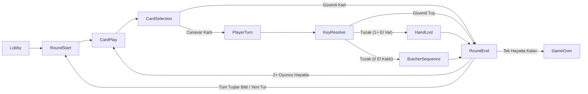

> ← [Ana Mimari İndeksine Dön](../../UYGULAMA_KAPSAMLI_REHBERI_VE_GUVENLIK_RAPORU.md) | **Modül 2/5:** Oyun Döngüsü, Yetenek Kartları & Hayalet Ekonomisi

# 3. Oyun Döngüsü, Yetenek Kartları & Hayalet Ekonomisi

Bu belge, **FingerMonster** çekirdek oyun döngüsünü, stratejik yetenek kartı ekonomisini, hayalet (Kasabın Yardımcısı) ruh enerjisi sistemini, kasap silahlarını ve yapay zekâ bot profillerini tanımlar.

---

## 3.1. Tur Tabanlı Oyun Döngüsü FSM (`GameState`)

Oyun akışı `Assets/_Project/Scripts/Core/GameEnums.cs` (`#L6-L18`) içinde tanımlı 10 durumlu sonlu durum makinesi (FSM) ile yönetilir:

| Durum (`GameState`) | Açıklama |
| :--- | :--- |
| `Lobby` | Lobi / bekleme aşaması |
| `RoundStart` | Yeni tur hazırlığı ve tuzakların daktilo tuşlarına dağıtımı |
| `CardPlay` | Sıradaki oyuncunun stratejik yetenek kartı oynama aşaması |
| `CardSelection` | 3 kart seçimi (*Push-Your-Luck* mini-oyunu: 1 Güvenli, 2 Canavar) |
| `PlayerTurn` | Kart seçiminde canavar çıkarsa oyuncunun daktilo tuşuna basma aşaması |
| `KeyResolve` | Basılan tuşun güvenli veya tuzak olarak çözümlenmesi (`keyResolveDelay = 0.4f`) |
| `HandLost` | Tuzak tetiklenmesi sonucu el kopma dramatizasyonu (`handLostDelay = 1.0f`) |
| `ButcherSequence` | İki elini kaybeden oyuncunun infaz sekansı (`butcherSequenceDuration = 3.0f`) |
| `RoundEnd` | Tur sonu değerlendirmesi ve hayalet enerji/pencere işlemleri |
| `GameOver` | Tek hayatta kalanın veya kazananın ilan edildiği bitiş durumu |

---

## 3.2. 6 Yetenek Kartı Mekaniği (`AbilityCardType`)

`GameEnums.cs` (`#L23-L32`) ve `GameSettings.cs` (`#L61-L86`, `#L154-L185`) içinde tanımlı 6 stratejik yetenek kartı bulunur:

| Kart (`AbilityCardType`) | Varsayılan Çekim Ağırlığı (`GameSettings`) | Mekanik Etki |
| :--- | :--- | :--- |
| `Shield` (Kalkan) | `weightShield = 15` | 1 tuzak tuş cezasını engeller |
| `Possess` (Ele Geçir) | `weightPossess = 22` | 3 kart seçiminde 1 canavar kartının yerini gösterir |
| `XRay` (Röntgen) | `weightXRay = 20` | Seçilen 1 daktilo tuşunun güvenli/tuzak olduğunu gösterir |
| `SkipTurn` (Sıra Atlat) | `weightSkipTurn = 15` | Mevcut turu tamamen pas geçer (üst üste 2 tur kullanılamaz) |
| `ReverseDirection` (Ters Yön) | `weightReverseDirection = 15` | Tur sonuna kadar sıra yönünü tersine çevirir |
| `Fog` (Sis) | `weightFog = 13` | Hedef rakibin bir sonraki 3 kart seçimini sisler ve `Possess` etkisini engeller |

**El Limiti ve Dağıtım Kuralları (`GameSettings.cs #L64-L78`):**
- `maxAbilityCardsInHand = 2` (oyuncu elinde aynı anda en fazla 2 kart tutabilir).
- `cardsDrawnPerRoundStart = 1` (her yeni tur başında hayattaki oyunculara 1 kart dağıtılır).
- `cardsDrawnOnSafeCardPass = 1` (3 kart seçiminde güvenli kart bulup sıra atlandığında 1 kart kazanılır).
- `keepAbilityCardsBetweenRounds = true` (turlar arasında eldeki kartlar korunur).
- `restoreHandsOnNewRound = false` (kopan eller kalıcıdır; yeni turda geri gelmez).

---

## 3.3. Hayalet Modu & Ruh Enerjisi Ekonomisi

İki elini kaybeden oyuncu elenerek **Hayalet (Kasabın Yardımcısı)** rolüne geçer. Arayüz sabitleri `Assets/_Project/Scripts/UI/GhostHUD.cs` (`#L29-L36`) ve denge değerleri `GameSettings.cs` (`#L88-L119`) içinde tanımlıdır:

| Parametre | `GhostHUD.cs` Sabiti | `GameSettings.cs` Varsayılanı | Açıklama |
| :--- | :--- | :--- | :--- |
| Maksimum Ruh Yuvası | `MaxSoulSlots = 3` | `ghostMaxSoulEnergy = 3` | Hayaletin biriktirebileceği azami ruh enerjisi |
| Başlangıç / Tur Başı Enerji | — | `ghostStartSoulEnergy = 1`, `ghostEnergyPerRound = 1` | Başlangıçta 1, her turda +1 ruh enerjisi |
| Tuş Lanetleme (`CurseKey`) | `CurseEnergyCost = 2` | `ghostCurseCost = 2` | Seçili bir tuşu lanetleme maliyeti (`maxCursesPerRound = 1`) |
| Atmosferik Etki (`GhostEffect`) | `EffectEnergyCost = 1` | `ghostEffectCost = 1` | 6 atmosferik etkiden birini tetikleme maliyeti |
| Etki Bekleme Süresi | `DefaultEffectCooldown = 3.0f` | `ghostEffectCooldown = 3.0f` | Atmosferik etkiler arası bekleme (`3.0s`) |
| Korkutma (`"Buuu!"`) | `ScareEnergyCost = 1` | `ghostScareCost = 1` | Yakındaki (`3.0m`) canlı oyuncuyu korkutma maliyeti |
| Korkutma Bekleme Süresi | `DefaultScareCooldown = 6.0f` | `ghostScareCooldown = 6f` | Korkutma eylemleri arası bekleme (`6.0s`) |
| Fırlatma (`ThrowableItemType`) | `ThrowEnergyCost = 1` | `ghostThrowCost = 1` | Nesne fırlatma maliyeti (azami menzil `12m`) |
| Fırlatma Bekleme Süresi | `DefaultThrowCooldown = 5.0f` | `ghostThrowCooldown = 5f` | Fırlatma eylemleri arası bekleme (`5.0s`) |

**Fırlatılabilir Çizgi Film Nesneleri (`GameEnums.cs #L91-L97`):**
1. `CreamPie` (Kremalı Pasta)
2. `Tomato` (Domates)
3. `PaperBall` (Kâğıt Topu)
4. `Sausage` (Sosis)

**Atmosferik Etkiler (`GameEnums.cs #L67-L75`):**
`FlickerLamp`, `EerieLaugh`, `FlyPaper`, `ColdBreeze`, `Applause`, `SadBoo`.

---

## 3.4. Kasap Silahları (`ExecutionWeaponType`)

Kasap infaz sırasında `Assets/_Project/Scripts/Butcher/ExecutionWeapons.cs` (`#L11-L91`) ve `WeaponData.cs` ile tanımlanan 4 silahtan birini kullanır:

| Silah (`ExecutionWeaponType`) | Türkçe Adı (`WeaponName`) | Çizgi Film Efekti (`ComicHitText`) | Kurma / Vuruş Süresi |
| :--- | :--- | :--- | :--- |
| `GiantMeatMallet` | Dev Çizgi Film Tokmağı | `BOONNNK!` | `0.90s` / `0.12s` |
| `FlyingCastIronPan` | Uçan Döküm Tava | `DÖNNNKKK!` | `0.75s` / `0.10s` |
| `SausageWhip` | Acılı Sosis Kırbacı | `ŞŞŞRAAAK!` | `0.85s` / `0.14s` |
| `CreamPieLauncher` | Kremalı Çizgi Film Pastası | `SSSPLLLAATTT!` | `0.70s` / `0.15s` |

**Tek Silah Kuşanma Kuralı:** Kasap tekil silah soketi üzerinde aynı anda yalnızca **1 silah** kuşanabilir (`ExecutionWeapons.GetWeaponData()` sırasıyla `GameSettings.butcherWeapons` veya `WeaponData.CreateRuntimeDefault()` üzerinden veriyi çözer).

---

## 3.5. Bot Kişilikleri ve Zorluk Seviyeleri

Bot profilleri `Assets/_Project/Scripts/AI/BotData.cs` (`#L10-L50`) ve oturum zorluk seviyeleri `Assets/_Project/Scripts/Core/GameSessionData.cs` (`#L18-L23`) içinde tanımlıdır:

**4 Bot Kişiliği (`BotPersonality`):**
- `Cesur` (**Feg** / `Kabadayi`): Hızlı karar verir (`1.0-1.6s`), risk almaktan çekinmez.
- `Urkek` (**Kenan** / `Korkak`): Tereddütlüdür (`2.0-3.0s`), kenar tuşları tercih eder.
- `Sinsi` (**Feyzi** / `Sinsi`): Olasılıkları tartar (`1.4-2.3s`), stratejik bekler.
- `Sovmen` (**MMG** / `Sovmen`): Gösterişçi ve teatraldir (`1.1-1.9s`).

**Zorluk Seviyeleri (`GameSessionData.Difficulty` & `BotDifficulty`):**
| Zorluk | Tuzak Sayısı (`GameSessionData.Difficulty`) | Bot Karar Mantığı (`BotDifficulty`) |
| :--- | :--- | :--- |
| **Kolay** | `Easy = 4` (4 Tuzak) | `Kolay`: Tamamen rastgele seçim, olasılık hesaplamaz (`emoteChance = 0.30f`) |
| **Normal** | `Normal = 6` (6 Tuzak) | `Normal`: Basılmış tuşları filtreler, dengeli insansı risk alır |
| **Zor** | `Nightmare = 8` (8 Tuzak) | `Zor`: Kalan tuzak/güvenli oranını matematiksel tartar (`P_tuzak = T_kalan / N_kalan`, `emoteChance = 0.85f`) |

---

> **Önceki Modül:** [← Modül 1/5: Kırılmaz Mimari & Tasarım Kuralları](01-design-and-rules.md) | **Sonraki Modül:** [Modül 3/5: Ağ Mimarisi, LAN Lobi & Senkronizasyon →](03-networking-and-lobby.md)
